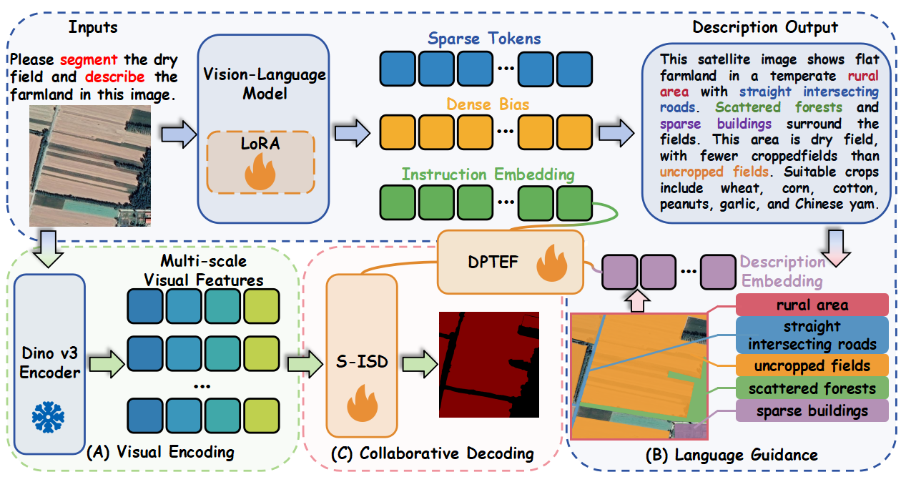

# Instruct-TAFS: An Instruction-Driven Vision-Language Model for Type-Aware Farmland Segmentation

## Usage

### 1. Installation

Use Python 3.11 or newer. Install matching CUDA-enabled PyTorch and TorchVision builds for your platform, then install the project dependencies:

~~~bash
python -m pip install -r requirements.txt
~~~

Your Transformers installation must provide `Qwen3VLForConditionalGeneration`.

### 2. Prepare pretrained models

- **Qwen3-VL:** prepare a complete local `Qwen3-VL-4B-Instruct` directory, including the model weights, configuration, tokenizer, and processor. Alternatively, use `Qwen/Qwen3-VL-4B-Instruct` as the model identifier to load it from Hugging Face.
- **DINOv3:** prepare the pretrained ViT-H+/16 checkpoint and the complete DINOv3 source repository. The source repository is expected at `models/dinov3/`; use `--dino-repo-dir` to specify another location.

### 3. Prepare the dataset

Organize each TAFS-VL split as follows:

~~~text
TAFS-VL/
├── train/
│   ├── img/
│   │   └── sample001.tif
│   └── json/
│       └── sample001.json
└── val/
    ├── img/
    │   └── sample002.tif
    └── json/
        └── sample002.json
~~~

Images and annotations must share the same filename stem. Supported image extensions are `.tif`, `.tiff`, `.png`, `.jpg`, and `.jpeg`, without case restrictions.

Each annotation contains Labelme-style polygons and an attribute description:

~~~json
{
  "img_description_eg": "Rectangular dry fields on flat terrain, surrounded by roads.",
  "shapes": [
    {
      "label": "Dry field",
      "points": [[10, 10], [100, 10], [100, 100], [10, 100]]
    }
  ]
}
~~~

Supported polygon labels are `farmland`, `Dry field`, and `Paddy field`. Masks are generated from the polygons, so a separate mask directory is not required. Descriptions are read from `img_description_eg`; use `--description-key` if your annotations use another field.

### 4. Training

Run the following command from the repository root, replacing the example paths with your own:

~~~bash
python train.py \
  --data-dir /path/to/TAFS-VL/train \
  --val-data-dir /path/to/TAFS-VL/val \
  --base-model /path/to/Qwen3-VL-4B-Instruct \
  --dino-ckpt /path/to/dinov3_vith16plus_pretrain.pth \
  --dino-size h \
  --epochs 10 \
  --batch-size 4 \
  --lr 5e-5 \
  --output-dir checkpoints/instruct_tafs
~~~

DINOv3 is frozen and LoRA is enabled by default. Training saves checkpoints, model configuration, processor files, and LoRA adapters under the output directory. The best checkpoint is saved when a validation split is provided. The training entry point uses one device per process.

Use `--gradient-checkpointing` and a smaller `--batch-size` if memory is limited. On Windows, `--num-workers 0` can be used when diagnosing data-loading issues. The multiline commands use Bash syntax; in PowerShell, run them on one line or use PowerShell line continuation.

### 5. Evaluation

~~~bash
python evaluate.py \
  --checkpoint checkpoints/instruct_tafs/best_model/model.pt \
  --val-data-dir /path/to/TAFS-VL/val \
  --eval-task all \
  --output-dir eval_results
~~~

Set `--eval-task` to `farmland`, `paddy_field`, or `dry_field` to evaluate one target, or `all` to evaluate all three. Evaluation saves generated descriptions, predicted masks, ground-truth masks, visualizations, and metrics under `eval_results/eval_results/` for the command above.

Model settings are loaded from `model_config.json` beside the checkpoint. If pretrained assets have moved, override their locations with `--base-model`, `--dino-ckpt`, and `--dino-repo-dir`.

